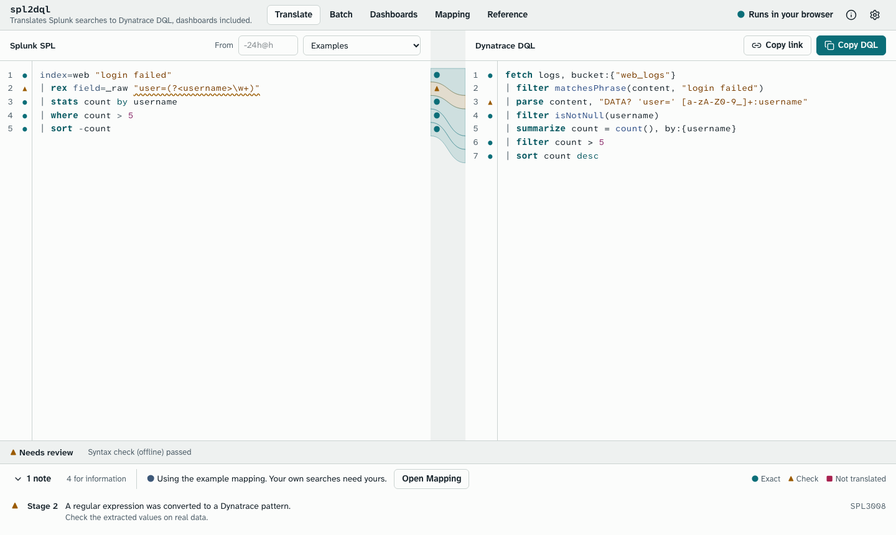
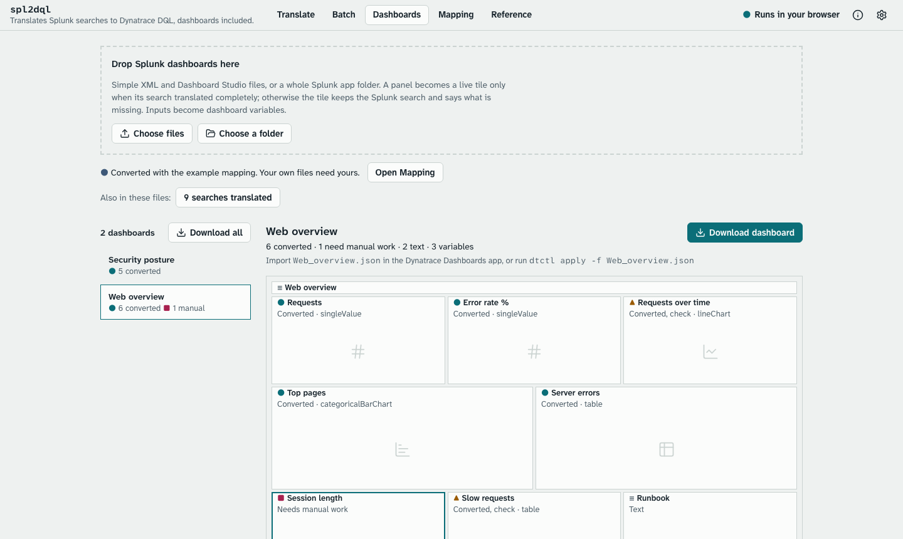
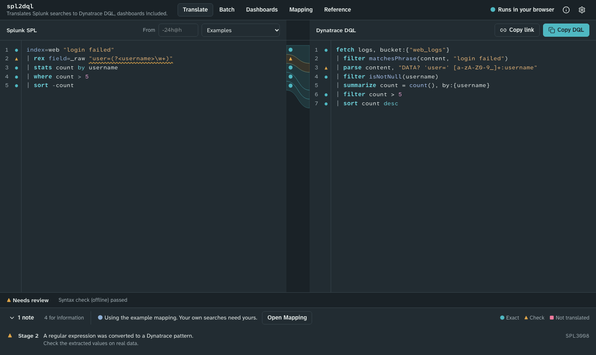
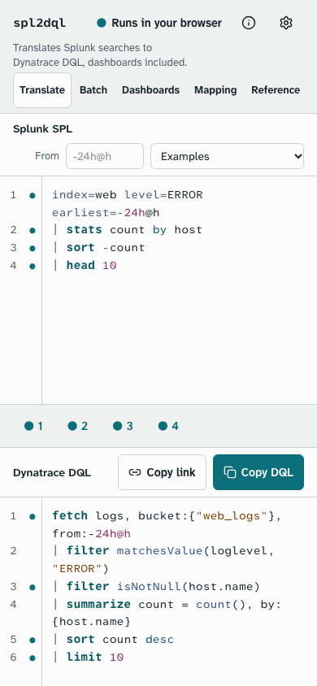

# spl2dql

**Move a Splunk app to Dynatrace: saved searches to DQL, dashboards to Dynatrace dashboards — offline, in your browser or terminal.**

[](https://github.com/gokul-babu/spl2dql/actions/workflows/ci.yml)
[](https://www.npmjs.com/package/spl2dql)


**Try it now: [spl2dql.pages.dev](https://spl2dql.pages.dev)** — the whole tool in your browser, nothing
uploaded — or `npx spl2dql serve` for the same page from your own machine.



Moving from Splunk to Dynatrace means rewriting hundreds of saved searches, dashboards and alerts
by hand. spl2dql does the mechanical part deterministically and tells you, stage by stage, exactly
which parts you still need to look at — without your searches ever leaving your machine.

```sh
spl2dql batch ./my_splunk_app --out ./out     # searches → .dql, dashboards → Dynatrace JSON, one report
```

- **A whole app, not one query.** Point it at a Splunk app folder: it reads `savedsearches.conf` with
  each search's saved time range, the dashboards, and `macros.conf`, `props.conf`, `eventtypes.conf`
  and `tags.conf` — so macros, field extractions, eventtypes and tags resolve without retyping them.
- **Dashboards too.** Simple XML and Dashboard Studio become Dynatrace dashboards: tiles in the same
  layout, inputs as variables. A panel goes live only when its search translated completely.
- **Deterministic.** The same search always produces the same DQL. There is no AI in it.
- **Honest.** Every SPL stage is marked **Exact**, **Check** or **Not translated**, with a plain-language
  note and a stable code (`SPL3001`…) explaining what differs and what to do.
- **Partial is useful.** A command with no DQL equivalent becomes a `// not translated:` comment line;
  everything around it is still translated.
- **Private by construction.** Nothing in spl2dql opens a network connection — not the translator, not
  the web app, not the CLI. It never asks for your tenant or a key, and it never will. CI fails if
  network code appears. No accounts, no telemetry.

> spl2dql does not prove that a translated query returns the same results as the original. It
> tells you where behaviour is known to differ; the final check is yours.

---

## Contents

- [What it translates](#what-it-translates)
- [Dashboards](#dashboards)
- [Quick start](#quick-start)
- [The web app](#the-web-app)
- [The command line](#the-command-line)
- [The mapping file](#the-mapping-file)
- [How it works](#how-it-works)
- [Project status](#project-status)
- [Development](#development)
- [Documentation](#documentation)
- [Security](#security)
- [Licence and notice](#licence-and-notice)

---

## What it translates

```spl
index=web status>=500 earliest=-24h@h
| stats count by host
| sort -count
| head 10
```

becomes

```dql
fetch logs, bucket:{"web_logs"}, from:-24h@h
| filter http.status >= 500
| filter isNotNull(host.name)
| summarize count = count(), by:{host.name}
| sort count desc
| limit 10
```

…with notes such as *"Rows with an empty group-by field are removed first, as Splunk does"* — the kind of
difference that silently changes alert counts if nobody spots it.

**109 SPL commands are recognised:**

| | Count | Examples |
|---|---|---|
| ● Exact | 24 | `search`, `where`, `eval`, `stats`, `chart`, `top`, `rare`, `table`, `fields`, `rename`, `sort`, `head`, `dedup`, `fillnull`, `bin`, `mvexpand`, `makemv` |
| ▲ Check (translated, with a documented difference) | 28 | `timechart`, `rex`, `regex`, `spath`, `lookup`, `inputlookup`, `join`, `eventstats`, `transaction`, `tstats`, `datamodel`, `mstats`, `convert`, `foreach` |
| ■ Not translated (with a specific reason) | 57 | `iplocation`, `map`, `predict`, `pivot`, `outputlookup`, `appendcols`, `streamstats` on raw events |

It also handles the parts that make SPL migrations hard:

- Splunk's case-insensitive search matching vs DQL's case-sensitive `==` (`matchesValue` / `matchesPhrase`)
- `NOT field=x` (keeps records without the field) vs `field!=x` (drops them) → `filterOut` vs `filter not …`
- time modifiers like `-24h@h`, `@w`, `-3mon@mon`, absolute dates in a chosen time zone
- search-time field extraction, which Grail does not do (`parse` with patterns from the mapping file)
- `rex` regular expressions converted to Dynatrace Pattern Language where that is exact — named
  captures of any shape, alternatives, `(?i)`, look-arounds, word boundaries, `max_match` — and refused otherwise
- data models: `tstats … from datamodel=Authentication` reads the data model's entry in the mapping
  file, and `Authentication.user` becomes whatever that field is called in Grail
- macros, subsearches used as filters, `first`/`last`/`earliest`/`latest` ordering, `timechart` series vs tables
- arithmetic that differs quietly: Splunk's `/` keeps the fraction and DQL's does not for whole
  numbers, a Splunk time is a number of seconds and a DQL timestamp is not

The full rule book is [docs/spec/spl-dql-mapping.md](docs/spec/spl-dql-mapping.md); the **Reference**
page in the app is generated from the engine itself.

---

## Dashboards



```sh
spl2dql dashboard web_overview.xml > web_overview.json     # then: dtctl apply -f web_overview.json
```

| Splunk | Dynatrace |
|---|---|
| Simple XML (`<dashboard>`, `<form>`) and Dashboard Studio (JSON) | one dashboard document |
| panels in rows, or placed by pixels | tiles on the 24-column grid, in the same arrangement |
| base searches, post-process searches, chained data sources, saved searches by name | one complete query per tile |
| line, area, column, bar, pie, single value, table … | the matching visualization, chosen from what the query really returns |
| inputs (`$host$`) | variables (`$host`): one value, several values, free text; a dropdown filled by a search becomes a variable filled by a query |
| the time picker | the dashboard's own time frame |

**A panel becomes a live tile only when its search translated completely.** Otherwise the tile is a
text tile that keeps the Splunk search, the DQL so far and what is missing — a dashboard that shows a
wrong number is worse than one that shows a gap. Drilldowns, visibility rules and custom
visualizations are not carried over, and each one is named in the report.
Details: [docs/spec/dashboards.md](docs/spec/dashboards.md).

---

## Quick start

Requirements: [mise](https://mise.jdx.dev) (pins Node 26 and pnpm 12), or Node ≥ 24 with pnpm.

```sh
git clone https://github.com/gokul-babu/spl2dql.git
cd spl2dql
mise install
pnpm install
pnpm build
```

Translate one search:

```sh
echo 'index=web status>=500 | stats count by host | sort -count' \
  | node packages/cli/bin/spl2dql.js translate -o pretty
```

Convert the sample app that ships with the repository — nine saved searches, two dashboards and
the configuration files they use:

```sh
node packages/cli/bin/spl2dql.js batch examples/splunk-app --out out
open out/report.html
```

Open the web app (fully offline):

```sh
node packages/cli/bin/spl2dql.js serve      # http://127.0.0.1:4680
```

---

## The web app



- **The seam** between the panes links every SPL stage to the DQL it produced. Its marker and colour
  show the stage's status; the same information is in both gutters and the notes, so nothing depends
  on colour or on the seam alone.
- **Notes** are grouped by stage. Selecting one jumps to that stage in both panes; names that need a
  mapping entry have an **Add mapping** button.
- **Batch** — drop `.spl`/`.txt` files, `savedsearches.conf`, a CSV with a `search` column, or a whole
  Splunk app folder; get a table sorted by confidence and a zip of results. Files are read in the
  browser and never uploaded.
- **Dashboards** — drop Splunk dashboards and see the converted layout itself: every tile at its
  place, marked **Converted** or **Needs manual work**, with its Splunk search beside its DQL.
- **Mapping** — edit the mapping file with live validation; every unresolved name in the current search
  is listed with **Add**, and `macros.conf`, `props.conf`, `eventtypes.conf` and `tags.conf` can be
  dropped in to fill it.
- **Load the sample app** on an empty Batch or Dashboards page shows a whole conversion in one click.
- **Reference** — every supported command and every note code, generated from the engine.
- **Copy link** puts the search in the URL fragment (never sent to a server).
- Installable, works with no connection, light and dark themes, keyboard shortcuts (`?`), WCAG 2.2 AA
  (checked with axe in CI), usable at phone width.

<p align="center"></p>

---

## The command line

```sh
spl2dql translate [file]              # one search (stdin when omitted); -o dql | json | pretty
spl2dql batch <inputs...> --out dir   # a Splunk app folder, searches, dashboards → .dql, dashboard JSON, report
spl2dql dashboard <inputs...>         # Splunk dashboards → Dynatrace dashboard files
spl2dql mapping init <inputs...>      # a mapping skeleton, filled in from the app's .conf files
spl2dql mapping check <file>          # validate a mapping file
spl2dql commands                      # the support matrix
spl2dql explain SPL3001               # what a note code means and what to do
spl2dql serve                         # the web app on 127.0.0.1 — everything runs in your browser
```

(`spl2dql` here is `node packages/cli/bin/spl2dql.js` until the package is published.)

A typical migration:

```sh
spl2dql mapping init ./my_splunk_app > spl2dql.mapping.yaml   # macros and extractions are filled in; add where the data lives
spl2dql batch ./my_splunk_app --out ./out --fail-on low
open ./out/report.html
dtctl apply -f ./out/dashboards/Web_overview.json             # your own tool, your own credentials
```

`batch` reads `.spl`/`.txt` files, `savedsearches.conf` (each search with its saved time range),
dashboards, and `macros.conf`, `props.conf`, `transforms.conf`, `eventtypes.conf` and `tags.conf`,
whose definitions are used during translation. Your mapping file always wins over them.

The HTML report is a single self-contained file with no JavaScript and a Content-Security-Policy that
forbids scripts; `--redact` masks quoted values, IP and e-mail addresses before sharing it.

| Exit code | Meaning |
|---|---|
| 0 | success |
| 1 | confidence at or below `--fail-on` |
| 2 | usage error, unreadable input or invalid mapping file |

---

## The mapping file

The translator never guesses environment names. Where Splunk data lives in Grail, what a field is
called there and what a macro expands to come from a mapping file
(`spl2dql.mapping.yaml` in the working directory is picked up automatically):

```yaml
version: 1
defaults:
  dataObject: logs
  timezone: Europe/Berlin          # for absolute dates in SPL
indexes:
  web:
    buckets: [web_logs]
  "fw_*":
    buckets: [firewall_logs]
sourcetypes:
  access_combined:
    filter: 'log.source == "/var/log/nginx/access.log"'
fields:
  status: http.status
  level: loglevel
fieldTypes:
  http.status: number
extractions:                        # Splunk extracted these at search time; Grail needs a parse
  response_time:
    from: content
    dpl: "DATA? 'response_time=' DOUBLE:response_time"
macros:
  recent(1):
    args: [span]
    definition: 'earliest=-$span$'
lookups:
  http_status:
    path: /lookups/http_status
    key: code
    columns: [code, description]
datamodels:                         # tstats … from datamodel=Authentication
  Authentication:
    buckets: [auth_logs]
    filter: 'event.category == "authentication"'
    fields:
      user: user.name
      src: client.ip
```

`macros`, `extractions`, `eventtypes` and `tags` do not have to be written by hand:
`spl2dql mapping init <app folder>` reads them from the app's own `.conf` files, and lists what it
could not carry over with the reason.

Without a mapping it still translates, using built-in names (`_raw`→`content`, `host`→`host.name`…)
and a note for every name it could not resolve. Unknown keys are errors, so typos are caught.
`--strict` turns every missing mapping into an error. Full schema:
[docs/spec/mapping-config.md](docs/spec/mapping-config.md).

---

## How it works

```
SPL text
  │  expand macros (from the mapping file, with a span map back to the input)
  │  split into stages at top-level |
  │  each stage → its command module → DQL AST commands, tagged with the stage they came from
  │       (field names resolved through the mapping; schema tracked: raw events / table / series)
  │  print the DQL AST (the only place DQL text is produced — quoting and escaping in one place)
  │  offline syntax check against a catalogue generated from Dynatrace's Apache-2.0 DQL reference
  ▼
DQL text + confidence + notes + a source map (which DQL lines came from which SPL stage)
```

```
packages/core          the translator, the dashboard converter and the readers for Splunk's files —
                       zero runtime dependencies, no I/O, browser and Node
packages/conformance   277 hand-written cases: SPL in → exact DQL and exact notes out
packages/cli           the CLI, batch reports and `spl2dql serve` (a loopback-only static server)
apps/web               React + CodeMirror web app, built with a strict Content-Security-Policy
examples/splunk-app    a made-up Splunk app used by the tests and the app's sample button
```

Boundaries are enforced in CI: `core` imports nothing outside itself, the web app may only use
`core`, and a scan fails the build if network APIs appear in `core`, the web app or its bundles, or
if the CLI opens an outbound connection.
More in [docs/ARCHITECTURE.md](docs/ARCHITECTURE.md).

---

## Project status

The translator, the dashboard converter, the CLI and the web app are built and tested. What is
**not** yet proven:

- **No real tenant yet.** Every generated query passes the offline DQL syntax check, and the syntax
  comes from Dynatrace's documentation, but none has been run on a real Dynatrace tenant; the mapping
  spec lists the assumptions to confirm there. No dashboard file has been imported into Dynatrace by
  this project either. Check a query yourself with `dtctl verify query` or a Dynatrace notebook.
- **No real-world coverage number yet.** That needs a sample of real saved searches through `batch`.
  A hand-written set of 65 realistic searches translates 52 completely and 13 in part; reviewing
  the first run by hand found seven wrong translations, all fixed since.
- **Still not translated:** `transaction` with options, `streamstats` on rows, `pivot`, geography
  (`iplocation`, `geostats`), ML commands, and regular expressions with back-references or repeated
  groups. Each is left as a `// not translated:` line with its reason.
- **Dashboards carry over structure, not styling:** no drilldowns, visibility rules, colours,
  thresholds or custom visualizations.

**It stays offline.** spl2dql will not connect to your Dynatrace tenant and has no AI in it — not
now, not later. A tool that reads your searches should not also need your credentials.

---

## Development

```sh
pnpm build            # core, web app, cli
pnpm check            # typecheck, lint, all Vitest tests, boundary rules, network scan
pnpm test:coverage    # with thresholds (core: 90 % lines, 80 % branches)
pnpm test:e2e         # Playwright: offline app, dashboards, accessibility in both themes, spl2dql serve
pnpm dev              # web app dev server
```

Current results: **850** unit, conformance, property and integration tests; **57** browser tests;
coverage 97 % lines / 89 % branches; `pnpm audit` clean. `pnpm gate` runs all of it, plus the secret
scan, the licence check and a look inside the npm packages, on the commit about to be published.

Translation behaviour is defined by the conformance corpus in
[packages/conformance/cases](packages/conformance/cases) — one Markdown file per area, each case an
SPL block, the exact expected DQL and the expected notes. Expected DQL is written from the spec or
documentation, never copied from the tool's output. See [CONTRIBUTING.md](CONTRIBUTING.md); adding an
SPL command follows [docs/spec/adding-a-command.md](docs/spec/adding-a-command.md).

---

## Documentation

| Document | |
|---|---|
| [ARCHITECTURE](docs/ARCHITECTURE.md) | Packages, boundaries, technology |
| [SPL → DQL mapping](docs/spec/spl-dql-mapping.md) | How each command, function and operator translates |
| [Translation engine](docs/spec/translation-engine.md) | Pipeline, AST, printer, invariants |
| [Mapping file](docs/spec/mapping-config.md) | Schema, resolution rules, and what is read from Splunk's `.conf` files |
| [Dashboards](docs/spec/dashboards.md) | How Splunk dashboards become Dynatrace dashboards |
| [UI](docs/spec/ui.md) · [CLI](docs/spec/cli.md) | Behaviour and wording |
| [Sample app](examples/splunk-app/) | A made-up Splunk app to try everything on |
| [Testing](docs/spec/testing.md) | Test layers and the conformance format |
| [Adding a command](docs/spec/adding-a-command.md) | The steps for a new SPL command, in order |
| [Releasing](docs/RELEASING.md) | How a version is cut and published |

---

## Security

Saved searches often contain internal host names, IP addresses and user names, so nothing leaves your
machine: spl2dql has no online features, reads no credentials and makes no network requests. The
codebase had an independent security review; every finding was fixed with a regression test. Every
parser of untrusted text has size and depth limits and is fuzzed by property tests; the XML reader
for dashboards never expands a declared entity and never reads an external one. Dependencies younger than seven days are refused and no install scripts run.

Please report vulnerabilities privately — see [SECURITY.md](SECURITY.md).

---

## Licence and notice

Apache-2.0 — see [LICENSE](LICENSE) and [NOTICE](NOTICE). The libraries and fonts bundled into the
web app are listed with their licences in `THIRD-PARTY-NOTICES.txt`, generated with every build
and shipped with the page and the npm package. The DQL command and function catalogue is
generated from the Apache-2.0 reference in [Dynatrace/dynatrace-for-ai](https://github.com/Dynatrace/dynatrace-for-ai)
(vendored under `third_party/`), which is also the reference for the Dynatrace dashboard format.

## Not affiliated

spl2dql is an independent open-source project. It is not affiliated with, endorsed by or supported
by Splunk Inc., Cisco or Dynatrace. Splunk, SPL, Dynatrace and DQL are trademarks of their
respective owners and are used only to describe what this tool works with. Provided without
warranty; check every translated query before relying on it.

## Privacy, conduct, contributing

- [PRIVACY.md](PRIVACY.md): no accounts, no analytics, no cookies; your searches stay on your machine.
- [CONTRIBUTING.md](CONTRIBUTING.md) and the [code of conduct](CODE_OF_CONDUCT.md).
- [CHANGELOG.md](CHANGELOG.md) and [how releases are made](docs/RELEASING.md).
